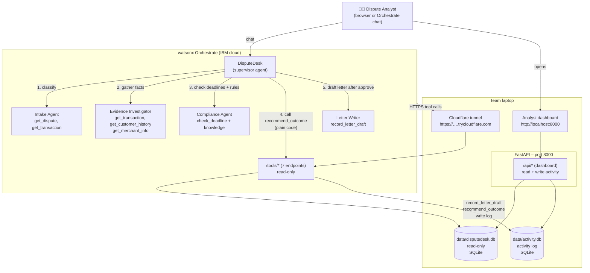

# DisputeDesk – Architecture

## System diagram



---

## How a dispute flows through the system (DSP-0046)

DSP-0046 is **Demo B**: CUST-0024 says "I never made this $340 online order. I don't know where this came from."

**Step 1 – Analyst types in Orchestrate**

> `Investigate dispute DSP-0046`

The supervisor asks the Intake Agent to classify it.

**Step 2 – Intake Agent**

Calls `get_dispute(DSP-0046)` → complaint text, `transaction_id=TXN-000531`, `customer_id=CUST-0024`.  
Calls `get_transaction(TXN-000531)` → $340 online purchase at an electronics merchant, `channel=online`, `device_id=DEV-0024`, `shipping_address_id=ADDR-0024`.  
Returns reason code **10.4** (card-absent fraud).

**Step 3 – Evidence Investigator**

Calls `get_customer_history(CUST-0024, merchant_id=MERCH-009, transaction_id=TXN-000531)`.  
Finds **3 earlier undisputed purchases** at the same merchant using the **same device and address**.  
`device_seen_before=true`, `address_seen_before=true`, `prior_disputes_lost=2`.  
Returns `history_fits_claim=no`.

**Step 4 – Compliance Agent**

Calls `check_deadline(DSP-0046, 10.4)` → filed 2026-10-12, transaction 2026-10-01, within 120-day network limit and 60-day Reg Z window → `within_time_limits=true`.  
Cites Reg Z §1026.13 from the knowledge base.

**Step 5 – recommend_outcome (plain code)**

The supervisor calls `recommend_outcome(DSP-0046, 10.4)` directly.  
The function sees: device seen before ✓, address seen before ✓, 3 prior undisputed purchases → not a "new device and new address with no history" case → **escalate**.  
Confidence: Medium (3/4 — history does not fit the claim).  
Returns the recommendation to the supervisor.

**Step 6 – Supervisor presents to analyst**

```
Recommendation: escalate
Reason code: 10.4 – Other fraud, card-absent
Confidence: Medium (3/4)
✅ Within time limits
✅ Evidence found
❌ History fits the claim
✅ Reason code clear
Key evidence:
  • TXN-000531: $340 at MERCH-009 on 2026-10-01 (credit card)
  • 3 earlier undisputed purchases at this merchant, same device, same address
  • 2 prior disputes resolved in the merchant's favour
Rule: Reg Z §1026.13 – within time limits
Next step: forward to a senior analyst for review.
Reply approve, edit or override.
```

**Step 7 – Analyst approves, Letter Writer drafts the letter**

The supervisor sends the case facts to the Letter Writer, which calls `record_letter_draft(DSP-0046, …)`.  
The dashboard's "Letter" pipeline stage lights up. The case detail page shows "Draft Letter for Review".

---

## Why deadlines and decisions are plain code

Language models are powerful at reading messy complaints and citing rules in plain English, but they are unreliable calculators. A model that correctly identifies reason code 13.1 may still miscalculate whether 150 days falls within 120 days, especially when the starting date depends on an expected delivery date stored in a database.

DisputeDesk solves this by separating the two concerns:

- **`check_deadline`** computes all dates exactly, in Python, from the database. It returns `within_time_limits`, `too_early`, the exact deadline dates, and a plain-English summary the agent can quote.
- **`recommend_outcome`** applies the written decision rules in Python, using the facts from the other tools. It returns `recommendation`, `confidence`, four named checks, and key evidence sentences. The supervisor presents the result exactly as returned — it does not reinterpret it.

The agents handle what they are good at: reading complaints, mapping language to reason codes, citing rules from documents, and writing polite letters. The code handles what it is good at: arithmetic, database lookups, and reproducible rule application. Every `recommend_outcome` result is logged to `data/activity.db`, so the same case always produces the same recommendation, and the audit trail is complete.
